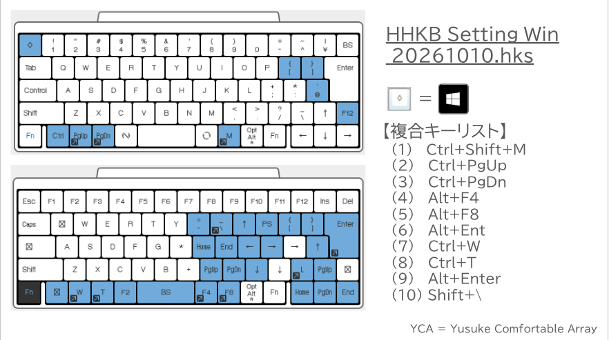
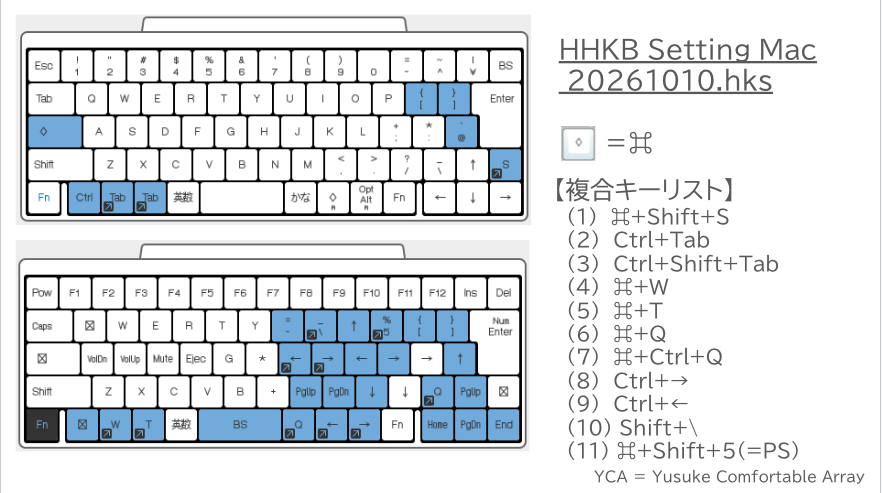

# HHKB-settings

## 1．目的

* 便利なHHKB設定を共有すること。

## 2．対象

* HHKB Professional JIS配列

* ファームウエア：A2.49 (2026年10月29日リリース)

## 3．物理配列

* 下記のとおりキーを入れ換える 
【@】→【「】 
【「】→【」】 
【」】→【@】 

## 4．論理配列
### 4-1．配列図

* Windows用キー配列

* Mac用キー配列

### 4-2．配列思想

* WindowsとMacで同じ動作をさせる。

* 使用頻度の高い操作はFn+右手キーに集約させる。

* ブラウザのタブ，およびExcelのシート移動はFn+左手で扱う。